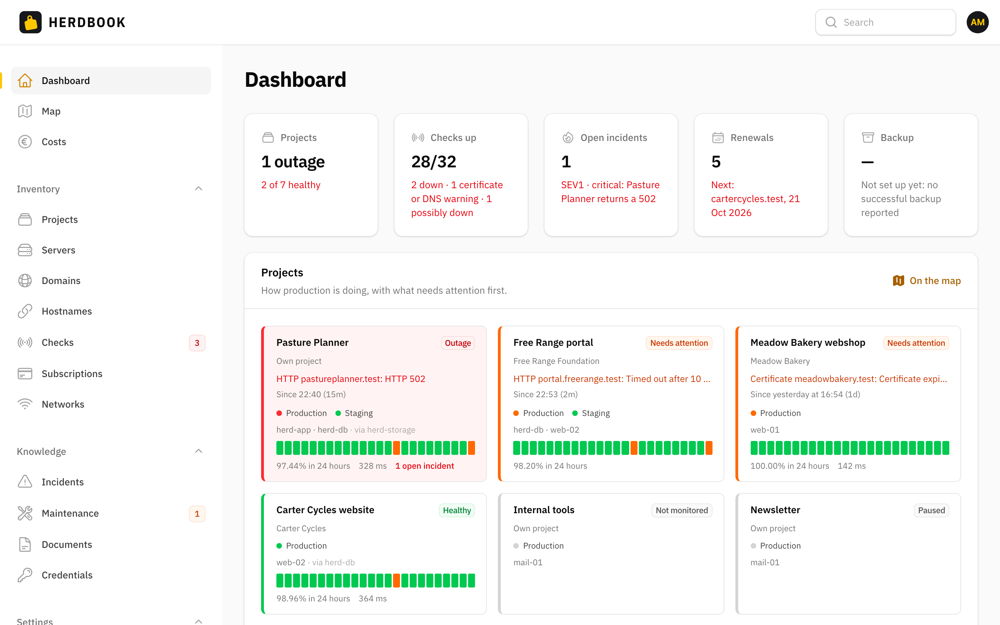
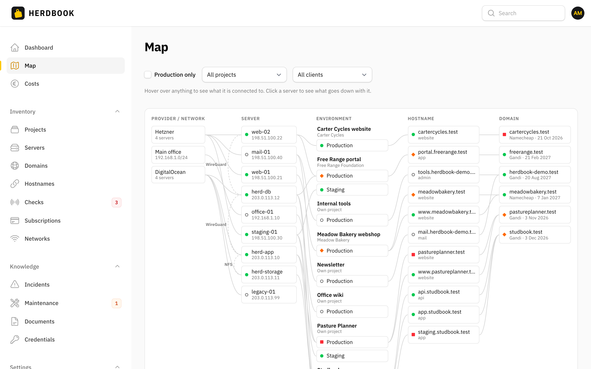
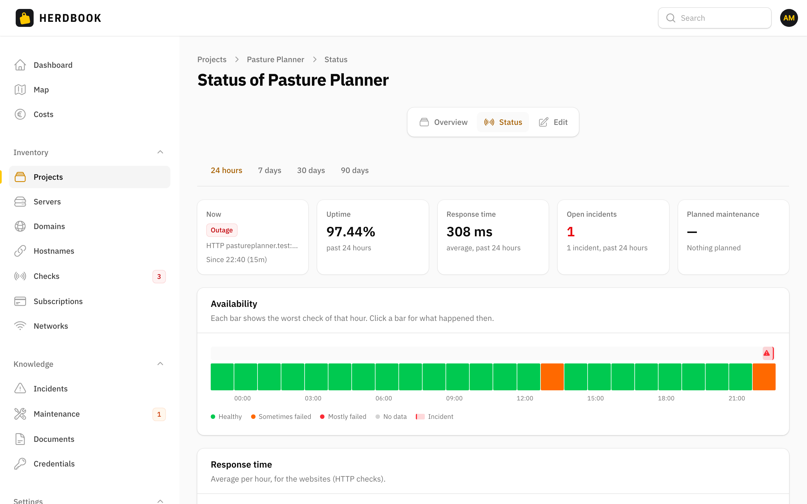
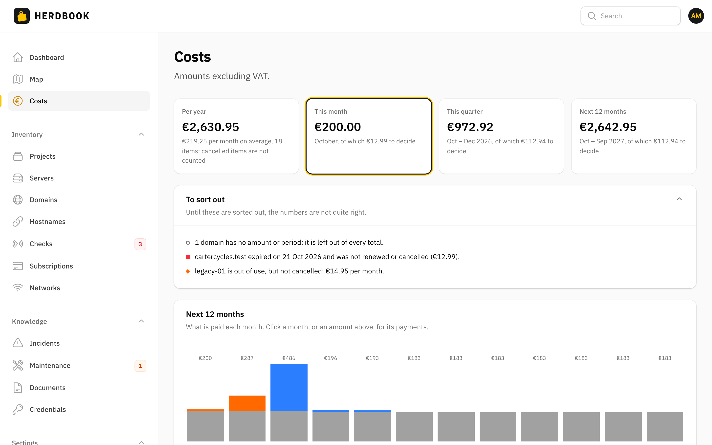
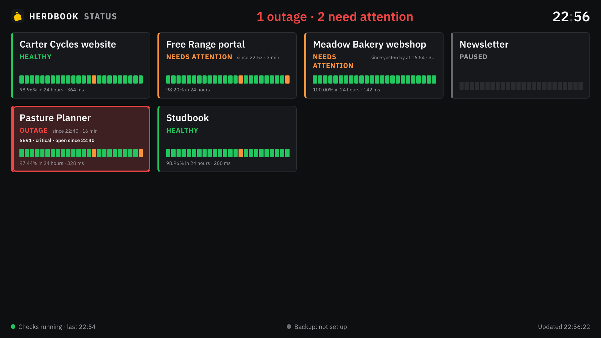

<p align="center">
  
</p>

<h1 align="center">Herdbook</h1>

<p align="center">
  <strong>Know what runs where.</strong><br>
  A self-hosted logbook for the applications, servers and domains you look after,<br>
  with uptime checks, incidents, runbooks, renewals and costs in one place.
</p>

<p align="center">
  <a href="LICENSE"></a>
  
  
  
  
</p>

<picture>
  <source media="(prefers-color-scheme: dark)" srcset="docs/images/dashboard-dark.png">
  
</picture>

A herdbook is the register a breeder keeps of every animal in the herd. This one is for your infrastructure.

## Why

Once you look after more than a handful of apps and servers, the overview slips. What runs where, and for whom? Where do you log in? Which domain expires next month? What did we do the last time this broke? What does it all cost per year?

The answers usually live in five places: a spreadsheet, the registrar's dashboard, an uptime monitor, incident notes spread over repositories, and the password manager. Herdbook gives you one overview and links to the rest. It is built for freelancers and small teams who run their own and their clients' applications, on a machine of their own.

## Features

**Inventory, centered on the project.** A project has environments (production, staging, …), and each environment runs on one or more servers with a role: app, database, storage, mail, proxy, worker. Around that: networks, domains and hostnames, providers, and clients (kept small on purpose: a name, an outage contact, a link to your invoicing tool). Dependencies between servers feed an impact analysis: pick a server and see everything that goes down with it.

**Monitoring and alerts.** HTTP, keyword, TLS certificate, TCP, DNS and ping checks, with sensible defaults per hostname. Thresholds filter out flapping, and when a check fails Herdbook first checks its own internet connection, so a broken line at your end wakes nobody up. Alerts go out through Pushover (critical ones break through Do Not Disturb), ntfy or email. A critical production check that stays down opens a draft incident by itself.

**Incidents and knowledge.** Incident reports with severity, a timeline and action items, linked to what was affected; existing markdown reports can be imported. Runbooks and other documents in markdown, with earlier versions you can restore. A maintenance log per server and project. Credentials are *references*: Herdbook links to the item in Vaultwarden or Bitwarden and never stores a secret.

**Renewals and costs.** Domains, server contracts, subscriptions and internet lines share one renewal model, with a 13-week calendar and a weekly digest. Recurring costs per year, quarter and month, a 12-month forecast, and totals per provider, project and client, with shared costs counted once.

<p align="center">
  <picture><source media="(prefers-color-scheme: dark)" srcset="docs/images/map-dark.png"></picture>
  <picture><source media="(prefers-color-scheme: dark)" srcset="docs/images/project-status-dark.png"></picture>
</p>

**Seeing it at a glance.** The dashboard puts the worst first. Every project has a status page with uptime and response time over 24 hours up to 90 days, with incidents and maintenance on the same timeline. The map draws providers, servers, environments, hostnames and domains with the lines between them. And a wall display for a TV or a Raspberry Pi shows how production is doing without ever showing a hostname or an address.

<p align="center">
  <picture><source media="(prefers-color-scheme: dark)" srcset="docs/images/costs-dark.png"></picture>
  
</p>

## Design Choices

- **Self-hosted, for one organization.** One database, one panel. Every account is an administrator, there is no sign-up, and two-factor authentication is required.
- **For a private network.** Reach it over Tailscale (no port is published at all), on your local network (HTTPS through Caddy with its own certificate authority), or both. It is not meant to face the public internet.
- **No secrets in the database.** Passwords and keys stay in your password manager; Herdbook refers to them.
- **Nothing from third parties.** Fonts, icons and avatars are served by Herdbook itself, and a strict Content-Security-Policy keeps every script, style and request on its own origin.
- **Not a CRM, not an invoicing tool.** And no integrations with hosting or registrar APIs: you describe what you run, including expiry dates.

## Quick Start

Try it locally with demo data. All you need is Docker.

```bash
git clone https://github.com/Peters-Development/herdbook.git
cd herdbook
cp .env.example .env                 # set HOST_UID to the output of `id -u`
docker compose up -d --build
docker compose exec app composer install
docker compose exec app php artisan key:generate
docker compose exec app php artisan migrate
docker compose exec app php artisan users:create
docker compose exec app php artisan demo:reset   # optional: fictional projects, servers and check history
```

Open http://localhost:16000 and set up two-factor authentication at the first sign-in. The [installation guide](docs/installation.md) explains each step.

## Running It for Real

Herdbook runs in Docker on a Linux host of your own. `COMPOSE_PROFILES` in `docker/box.env` picks how it is reached:

| Profile | What you get |
|---|---|
| `tailscale` | `https://herdbook.<tailnet>.ts.net`, through a Tailscale sidecar. No published port. |
| `lan` | `https://<LAN_IP>` on your local network, through Caddy with its own certificate authority. |
| `vaultwarden` | An optional Vaultwarden password vault next to it, on your tailnet. |

Deploying, updating and rolling back is one script (`docker/deploy.sh`), and nightly restic backups go to the host itself or append-only to a NAS. Start with [Deployment](docs/deployment.md), then [Networking](docs/networking.md) and [Backups](docs/backups.md).

## Documentation

The full documentation lives in [`docs/`](docs/README.md):

- **Getting started:** [Installation](docs/installation.md) · [Deployment](docs/deployment.md) · [Networking](docs/networking.md) · [Configuration](docs/configuration.md) · [Backups](docs/backups.md) · [Vaultwarden](docs/vaultwarden.md)
- **Using Herdbook:** [Inventory](docs/inventory.md) · [Monitoring](docs/monitoring.md) · [Alerts](docs/alerts.md) · [Incidents](docs/incidents.md) · [Knowledge](docs/knowledge.md) · [Maintenance](docs/maintenance.md) · [Renewals](docs/renewals.md) · [Costs](docs/costs.md) · [Dashboard and Map](docs/dashboard.md) · [Status Screen](docs/status-screen.md)
- **Reference:** [Commands](docs/commands.md) · [Security](docs/security.md) · [Translations](docs/translations.md) · [Development](docs/development.md)

## Languages

The interface speaks **English** and **Dutch**. `APP_LOCALE` sets the default, and every account can pick its own language in its profile. Adding a language takes a few files: see [Translations](docs/translations.md). Contributions are very welcome.

## Built With

PHP 8.5, [Laravel](https://laravel.com) 13, [Filament](https://filamentphp.com) 5 (Livewire 4) and MySQL 8.4. Queue and cache use the database, so there is no Redis, and there is no JavaScript build step. The font is [IBM Plex](https://www.ibm.com/plex/), served by Herdbook itself.

## Contributing

Bug reports, fixes, translations and ideas are welcome. Read [CONTRIBUTING.md](CONTRIBUTING.md) first; [Development](docs/development.md) explains the architecture and the conventions. Please report security issues privately, as described in [SECURITY.md](SECURITY.md).

## License

Herdbook is free software, licensed under the [GNU Affero General Public License v3.0 or later](LICENSE). You may use, study, change and share it; if you run a modified version for others over a network, you must offer them its source too.

Copyright © 2026 Peters Development.
